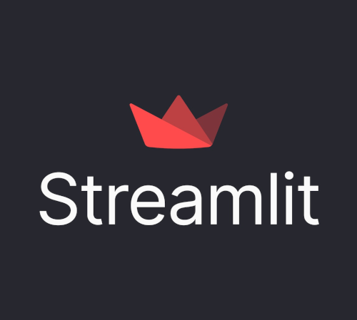

# CS101 Data Structures

Activity 08: Building Web-Based Data Applications with Streamlit

## Assigned and Due

- **Assigned**: Friday, 6 November 2026 at class time
- **Due and Expiration**: Monday, 9 November 2026 at class time

Note: the expiration date is the last date you can submit your work for a grade.

<center>



</center>

## Table of Contents
- [CS101 Data Structures](#cs101-data-structures)
  - [Assigned and Due](#assigned-and-due)
  - [Table of Contents](#table-of-contents)
  - [Overview](#overview)
  - [Learning Objectives](#learning-objectives)
  - [Project Goals](#project-goals)
  - [Instructions](#instructions)
    - [Setting Up the Environment (Do This First!)](#setting-up-the-environment-do-this-first)
      - [For macOS and Linux:](#for-macos-and-linux)
      - [For Windows (Command Prompt or PowerShell):](#for-windows-command-prompt-or-powershell)
    - [Completing the Tutorials](#completing-the-tutorials)
    - [Running Applications](#running-applications)
  - [Deliverable](#deliverable)
  - [Submission](#submission)
  - [GatorGrade](#gatorgrade)
  - [Seeking Assistance](#seeking-assistance)
    - [Common Issues and Solutions](#common-issues-and-solutions)
  - [Additional Resources](#additional-resources)
  - [Learning Extensions (Optional)](#learning-extensions-optional)

## Overview

In this activity you will complete three tutorials that introduce **Streamlit**, a powerful Python library for creating interactive web applications. Streamlit allows you to transform data scripts into shareable web apps using only Python - no HTML, CSS, or JavaScript required.

You will use the UV package manager to create a project environment and work with Streamlit to:
- Build interactive user interfaces with buttons, sliders, and input widgets
- Load and visualize data from CSV files with charts, plots, and heatmaps
- Perform text analysis including sentiment analysis and word frequency
- Create data dashboards that run in the browser for convenient user interaction

By the end of this activity, you will understand how Python can be used to create professional-looking web applications for data analysis and visualization. You will learn concepts including reactive programming, data manipulation with Pandas, and Natural Language Processing basics.

**Important:** All three tutorials use the **same virtual environment**, so you only need to set up the environment once at the project root level!


## Learning Objectives

By completing this activity, you will be able to:

1. **Create interactive web applications** using Streamlit's widget system and reactive programming model
2. **Manipulate and visualize data** using Pandas, Matplotlib, Seaborn, and Plotly
3. **Perform text analysis** including tokenization, sentiment analysis, and word frequency analysis
4. **Use the UV package manager** to create and manage Python virtual environments
5. **Build data dashboards** that allow users to explore datasets through filtering and interactive visualizations
6. **Apply Natural Language Processing** techniques to extract insights from text data
7. **Work across platforms** with commands that function on Linux, macOS, and Windows


## Project Goals

This activity guides you through three progressive tutorials:

**Tutorial 1: Interactive Streamlit Application**

- [Tutorial_01](tutorials/tutorial_01_interactive_streamlit.md)
  - Learn what Streamlit is and how reactive programming works
  - Create interactive widgets (buttons, sliders, text inputs, select boxes)
  - Use layout tools (columns, expanders, sidebars)
  - Understand how Streamlit automatically reruns when users interact
  - Build a foundation for more complex applications

**Tutorial 2: Data Visualization Dashboard**

- [Tutorial_02](tutorials/tutorial_02_data_visualization.md)
  - Load CSV data using Pandas
  - Create multiple types of visualizations (line charts, bar charts, scatter plots, heatmaps)
  - Display interactive tables and data statistics
  - Implement data filtering and custom chart creation
  - Export analysis results for download
  - Work with three different datasets (sales, weather, student grades)

**Tutorial 3: Text Analysis Tool**

- [Tutorial_03](tutorials/tutorial_03_text_analysis.md)
  - Load and process text from files or user input
  - Perform sentiment analysis to determine text tone (positive/negative/neutral)
  - Analyze word frequencies with stopword removal
  - Generate word cloud visualizations
  - Compare multiple texts side by side
  - Extract text statistics and insights


## Instructions

### Setting Up the Environment (Do This First!)

**IMPORTANT:** All three tutorials share the same virtual environment. Set this up once before starting the tutorials:

#### For macOS and Linux:

```bash
# Navigate to the project root (change 09_activity_repository/ with whatever your repository is called.)
cd 09_activity_repository/

# Initialize the UV project
uv init

# Install all required packages
uv add streamlit pandas matplotlib seaborn plotly wordcloud textblob nltk
```

#### For Windows (Command Prompt or PowerShell):

```cmd
# Navigate to the project repository root
cd 09_activity_repository\

# Initialize the UV project
uv init

# Install all required packages
uv add streamlit pandas matplotlib seaborn plotly wordcloud textblob nltk
```

### Completing the Tutorials

1. **Read** each tutorial document carefully:
   - [Tutorial_01: Interactive Streamlit Application](tutorials/tutorial_01_interactive_streamlit.md)
   - [Tutorial_02: Data Visualization Dashboard](tutorials/tutorial_02_data_visualization.md)
   - [Tutorial_03: Text Analysis Tool](tutorials/tutorial_03_text_analysis.md)

2. **Follow** the step-by-step instructions in each tutorial

3. **Complete** the TODO items marked in the Python source files:
   - `src/tutorial_01_interactive_streamlit/interactive_app.py`
   - `src/tutorial_02_data_visualization/data_dashboard.py`
   - `src/tutorial_03_text_analysis/text_analyzer.py`

4. **Run** each application using the UV commands provided in the tutorial:
   ```bash
   # From the appropriate tutorial directory:
   uv run streamlit run <filename>.py
   ```

5. **Experiment** by making modifications and trying different inputs

6. **Answer** the reflection questions in `writing/reflection.md`

### Running Applications

Each tutorial application can be run from its respective directory. For example:

**macOS/Linux:**
```bash
cd src/tutorial_01_interactive_streamlit/
uv run streamlit run interactive_app.py
```

**Windows:**
```cmd
cd src\tutorial_01_interactive_streamlit\
uv run streamlit run interactive_app.py
```

**To stop any running Streamlit app:** Press `Ctrl+C` in the terminal (works on all operating systems).


## Deliverable

You will submit:
- Completed Python files with all TODOs resolved for each tutorial:
  - `src/tutorial_01_interactive_streamlit/interactive_app.py`
  - `src/tutorial_02_data_visualization/data_dashboard.py`
  - `src/tutorial_03_text_analysis/text_analyzer.py`
- Completed `writing/reflection.md` with answers to all reflection questions
- All data files remain in their respective `data/` folders

**Note:** You do NOT need to submit screenshots or recordings of your running applications. We will verify functionality by running your code.

## Submission

This is a check mark grade.

Please submit this assignment by pushing your work to your GitHub repository. Ensure that:
- All TODO items have been replaced with working code
- All applications run without errors
- The reflection document is complete
- Your name has been added to all source files

Use meaningful commit messages that describe what you accomplished:
```bash
git add .
git commit -m "Complete Tutorial 1: Interactive widgets"
git push
```


## GatorGrade

You can check your work by running GatorGrade:

```bash
gatorgrade --config config/gatorgrade.yml
```

This will verify that:
- All required files exist
- TODO items have been removed
- Reflection questions have been answered


## Seeking Assistance

If you encounter difficulties:

1. **Read the error messages carefully** - Python and Streamlit provide helpful error messages
2. **Check the tutorial documents** - They contain detailed explanations
3. **Consult the Streamlit documentation** - https://docs.streamlit.io/
4. **Ask during office hours** - Bring specific questions about what you've tried
5. **Use the course forums** - Share error messages and code snippets
6. **Work with classmates** - Collaborate on understanding concepts (but write your own code)

### Common Issues and Solutions

**Issue:** "Module not found" error
- **Solution:** Make sure you've run `uv add <package>` to install dependencies

**Issue:** Streamlit won't start
- **Solution:** Check that you're in the correct directory and using `uv run streamlit run <file>.py`

**Issue:** Port already in use
- **Solution:** Stop any other running Streamlit apps with `Ctrl+C`, or specify a different port: `uv run streamlit run app.py --server.port 8502`

**Issue:** Changes aren't appearing
- **Solution:** Save your Python file - Streamlit automatically detects changes and prompts you to rerun

**Issue:** NLTK data not found (Tutorial 3)
- **Solution:** The app should download this automatically on first run. If not, check your internet connection.


## Additional Resources

- **Streamlit Documentation:** https://docs.streamlit.io/
- **Pandas Documentation:** https://pandas.pydata.org/docs/
- **Plotly Documentation:** https://plotly.com/python/
- **TextBlob Documentation:** https://textblob.readthedocs.io/
- **Streamlit Gallery:** https://streamlit.io/gallery (for inspiration!)


## Learning Extensions (Optional)

Look for an extra challenge, anyone?! After completing the required tutorials, challenge yourself;

1. **Combine the tutorials** - Create a multi-page app that includes all three features
2. **Add your own data** - Find CSV files or text documents to analyze
3. **Deploy your app** - Create a free account at https://streamlit.io/cloud and share your work
4. **Enhance visualizations** - Try different chart types and styling options
5. **Add more NLP features** - Implement named entity recognition or topic modeling
6. **Create a custom project** - Build a dashboard for a topic you're interested in


**Remember:** The goal is not just to complete the TODOs, but to understand how interactive web applications work and how Python can be used to create useful tools for data analysis and visualization.

Good luck and have fun building!
